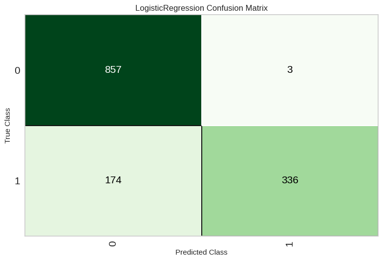
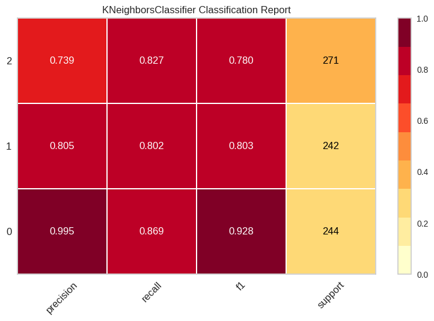
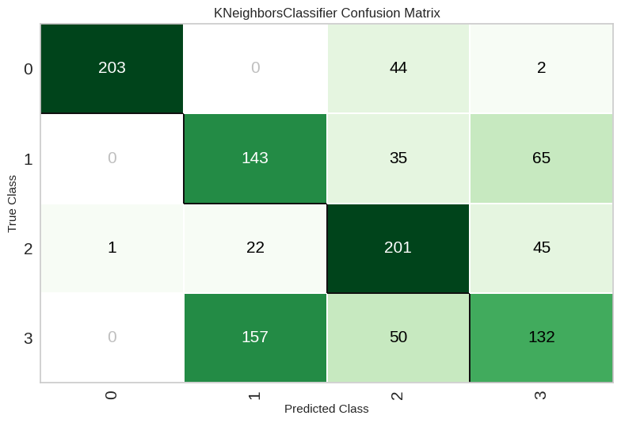

# Authorship recognition for large language models

Two questions about a piece of text. Was it written by a machine, and if it
was, which model wrote it. Bachelor's project, 2024.

The corpora are deliberately mismatched, Reddit comments and arXiv abstracts,
so a classifier cannot lean on a single register. The machine half was
generated by ChatGPT, Cohere and Davinci.

| Question | Classes | Documents | Best model | Held out accuracy |
|---|---|---|---|---|
| Is this machine written? | human, LLM | 5,705 | Logistic Regression | **87.6%** |
| Which model wrote it? | chatgpt, cohere, davinci | 3,152 | K Neighbors | **82.4%** |
| Both at once | human and the three | 4,583 | K Neighbors | **61.2%** |

Three things came out of it that the accuracy numbers alone do not say.

**The detector is lopsided.** It catches 857 of 860 machine documents and
misreads 174 of 510 human ones as machine. Useful as a filter, dangerous as an
accusation.

**ChatGPT has a fingerprint.** Precision 0.995 in both runs that include it,
against 0.74 to 0.81 for Cohere and Davinci, which blur into each other.

**Merging the two questions breaks the harder one.** Asked to pick between
human and three generators at once, human recall falls to 0.389, below every
machine class. That is the argument for two models in sequence.

---

## The data

Each document carries the label of whoever wrote it.

| Column | Meaning |
|---|---|
| `text` | The document. Reddit comment or arXiv abstract. |
| `model` | The target. `human` and `LLM` for detection, the generator name for attribution. |
| `source` | `reddit` or `arxiv`. |
| `label` | Finer grained class, 0 to 3, kept for analysis and ignored in training. |
| `text_length` | Characters. Ranges from 194 to 13,220, mean 2,386. |
| `id` | Row identifier, ignored in training. |

Every run splits 80/20 with a fixed seed. `label`, `source` and `id` are
dropped before fitting, so the model never sees which corpus a document came
from and cannot learn "arXiv implies machine" as a shortcut.

## Features

Two representations of the same text, used together.

**Word2Vec**, trained on this corpus rather than downloaded: 100 dimensions,
window of 5, minimum count of 1. A document vector is the mean of its word
vectors. Mean pooling throws away word order, which matters less here than it
would for sentiment, because what separates the classes is vocabulary and
register rather than syntax.

**TF-IDF**, which keeps the specific words a model reaches for. Word2Vec puts
"nevertheless" and "however" in roughly the same place; TF-IDF notices that one
of them turns up far more often in machine text than in a person's.

Training embeddings on a few thousand documents is the obvious weakness. A
pretrained model would have better vectors for rare words. The trade was
deliberate: these embeddings are fitted to the domain, including the LLM
phrasing of 2024, which a general purpose model trained on older text
represents less sharply.

## Detection: human against machine

5,705 documents, 4,564 for training and 1,141 held out. PyCaret fits every
candidate on identical folds, so the comparison means something. Mean across
cross validation folds:

| | Accuracy | AUC | Recall | Precision | F1 | Kappa |
|---|---|---|---|---|---|---|
| **Logistic Regression** | **0.8632** | 0.8444 | 0.8632 | 0.8743 | **0.8571** | 0.6892 |
| Naive Bayes | 0.8560 | 0.8449 | 0.8560 | 0.8707 | 0.8482 | 0.6700 |
| K Neighbors | 0.7868 | 0.8032 | 0.7868 | 0.7845 | 0.7844 | 0.5351 |
| Extra Trees | 0.7865 | 0.8074 | 0.7865 | 0.8409 | 0.7585 | 0.4821 |
| Decision Tree | 0.7442 | 0.6564 | 0.7442 | 0.8184 | 0.6985 | 0.3634 |
| Random Forest | 0.7442 | 0.8256 | 0.7442 | 0.8184 | 0.6985 | 0.3634 |
| Ada Boost | 0.7442 | 0.6564 | 0.7442 | 0.8184 | 0.6985 | 0.3634 |

The linear models win and the trees collapse: three of them land on exactly
0.7442, which is a majority class rule wearing a model's name. That is what
sparse high dimensional text features do to a tree given a few thousand rows.

Logistic regression was tuned over 10 folds and 10 candidate configurations,
100 fits. On the 1,141 held out documents:

| Accuracy | AUC | Recall | Precision | F1 | Kappa | MCC |
|---|---|---|---|---|---|---|
| 0.8764 | 0.8402 | 0.8764 | 0.8959 | 0.8697 | 0.7155 | 0.7454 |

MCC of 0.745 is the number worth quoting over accuracy, because it accounts for
both classes and both kinds of error.

### Where the errors sit



Class 0 is `LLM`, class 1 is `human`, which is the alphabetical order the label
encoder uses. The matrix says something the headline accuracy hides: machine
text is caught almost perfectly, 857 of 860, while 174 of 510 human documents
are called machine. Human recall is 0.659 against 0.997 for machine.

Part of that is the class balance, roughly 63% machine in this split, and
training rebalancing does not fully undo it at prediction time. The practical
reading: this model is a reasonable first pass filter for finding machine text,
and the wrong tool for accusing a person of using one. Any deployment would
need the threshold moved and the cost of a false accusation priced in.

## Attribution: which model wrote it

3,152 documents from ChatGPT, Cohere and Davinci, 630 held out. Here the
ranking inverts. K nearest neighbours wins at 0.7966 cross validation accuracy
against 0.7819 for logistic regression, and holds up out of sample:

| Accuracy | AUC | Recall | Precision | F1 |
|---|---|---|---|---|
| 0.8238 | 0.9318 | 0.8238 | 0.8366 | 0.8262 |

An AUC of 0.93 on a three way problem says the generators have genuinely
different fingerprints in this feature space. Neighbourhood methods suit that:
each generator occupies its own region, and a linear boundary through three
overlapping regions gives up more than a local vote does.



Per class, 0 is chatgpt, 1 cohere, 2 davinci. ChatGPT is nearly unmistakable at
0.995 precision and 0.928 F1. Cohere and Davinci sit around 0.78 to 0.80 and
the errors between them run both ways, so the three way score is carried by one
very distinctive generator and two that resemble each other.

## Both at once, and why not to

4,583 documents, four classes, human alongside the three generators. Same
features, same procedure, 917 held out:

| Accuracy | AUC | Recall | Precision | F1 | MCC |
|---|---|---|---|---|---|
| 0.6118 | 0.8409 | 0.6118 | 0.6271 | 0.6159 | 0.4802 |

61% against 88% for detection and 82% for attribution. The combined task is not
the average of the two, it is worse than either.



Classes are 0 chatgpt, 1 cohere, 2 davinci, 3 human. Human is now the worst
class in the problem: 132 correct out of 339, with 157 predicted as Cohere.
Precision 0.541 and recall 0.389, below every machine class, while ChatGPT
holds at 0.995 precision.

So the damage is specific rather than general. Human text does not become
uniformly confusable, it gets absorbed by the generator it most resembles,
which is exactly the failure that a two stage design avoids: decide machine or
not, then ask which machine, and never make one boundary carry both jobs.

Note also that AUC stays at 0.84 while accuracy falls to 0.61. The ranking is
still informative; it is the decision rule that breaks down.

## The notebooks

| Notebook | Documents | Task |
|---|---|---|
| `01-detection-human-vs-llm.ipynb` | 5,705 | Detection. The final run, and the headline number. |
| `02-attribution-chatgpt-cohere-davinci.ipynb` | 3,152 | Attribution between the three generators. |
| `03-combined-four-class.ipynb` | 4,583 | All four classes at once, the run that argues against doing so. |

Every figure in this README is an output of those notebooks, extracted to
`figures/`.

## Known limits

**One split, one seed.** Every number above comes from a single 80/20 split
with `session_id=123`. Repeating across seeds would put error bars on these,
and I would not defend the third decimal place without them.

**The detector's bias is not fixed, only noted.** Training rebalancing was
enabled, the prediction threshold was left at its default, and human recall of
0.659 is the result. Moving the threshold and reporting a precision recall
curve is the first thing I would add.

**Domain and authorship are tangled.** arXiv abstracts and Reddit comments
differ in length, register and structure before authorship is considered.
`source` is excluded from the features, but a model can rediscover it from the
text, so some of the 87.6% is probably domain separation wearing authorship's
clothes. A per corpus breakdown would settle it.

**2024 text.** The machine half comes from ChatGPT, Cohere and Davinci as they
were. Detection that leans on phrasing habits ages with the generation that
produced it, and none of these numbers should be assumed to transfer to a model
released since.

**Mean pooled embeddings discard word order.** Fine for register, weak for
anything structural. The obvious next step is a transformer encoder, which
would also make the comparisons above a fairer fight.

**The two stages are not wired together.** Each notebook runs its own
experiment. Chaining them, so a document classified as machine is passed to the
attribution model, is the natural next step and is not done here.

## Running it

The notebooks were written in Colab and run top to bottom. The data file
`Bachtrain2.jsonl` is loaded near the top of each and is not in this
repository.

```
pip install -r requirements.txt
jupyter notebook 01-detection-human-vs-llm.ipynb
```

## Stack

Python, PyCaret, scikit-learn, Gensim Word2Vec, TF-IDF, pandas, NumPy, Jupyter.
